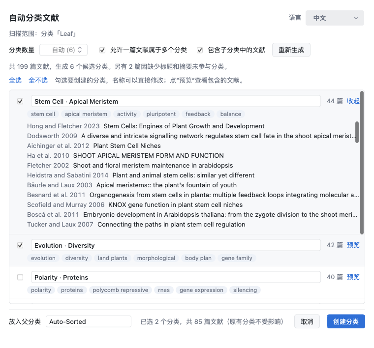

[English](README.md) | **简体中文**

# Auto Sort — Zotero 自动分类插件

扫描文库（或某个分类）里的文献，在本地推荐主题分类。你勾选想要的分类后，插件会在 `Auto-Sorted` 父分类下创建子分类，并把文献加进去。原有分类不动；Zotero 的分类只是引用，不会复制附件。

支持 Zotero 7 – 10（在 Zotero 10.0.6 上测试过）。界面提供中文和英文两种语言。

## 截图

工具栏按钮（三个叠放的文件夹）位于文献列表上方、“新建笔记”的右边：


对话框列出候选分类及其关键词。你可以勾选想要的分类、修改名称、预览包含的文献，确认后再创建：



界面也提供英文版（[见英文 README](README.md#screenshots)）。

## 下载与安装

**[⬇ 下载最新版本](https://github.com/Wegene38/zotero-auto-sort/releases/latest)**（当前版本：[v0.1.1](https://github.com/Wegene38/zotero-auto-sort/releases/tag/v0.1.1)）

1. 在 Release 页面的 **Assets** 中下载 `auto-sort-<版本号>.xpi`。如果用 Firefox，请右键选择 **链接另存为…**，因为直接点击会被 Firefox 当成它自己的扩展来安装。
2. 在 Zotero 中打开 **工具 → 插件**。
3. 点击右上角的齿轮图标，选择 **Install Add-on From File…**，然后选中下载的 `.xpi` 文件。
4. 文献列表上方会出现工具栏按钮（三个叠放的文件夹），无需重启。

需要 Zotero 7 或更高版本（已在 Zotero 10.0.6 上测试）。安装后，有新版本发布时 Zotero 会自动更新插件。

## 使用

- **工具栏按钮**（文献列表上方、“新建笔记”右边的三个叠放文件夹图标）：选中分类时扫描该分类，选中文库时扫描整个文库
- **工具 → 自动分类文献…**：扫描当前选中的整个文库
- **右键分类 → 自动分类此处文献…**：只扫描这个分类（可选是否包含子分类）

在对话框中可以：

- 调整分类数量，或者勾选/取消“允许一篇文献属于多个分类”，然后点“重新生成”
- 勾选要创建的分类、直接修改分类名称、点“预览”查看文献（点击标题会在 Zotero 中定位到该文献）
- 修改父分类名称（默认 `Auto-Sorted`）
- 在右上角切换界面语言（跟随 Zotero / English / 中文），选择会被记住

重复运行是安全的：同名的父分类和子分类会复用，已经在里面的文献不会重复添加。

## 算法（纯本地，不联网）

`addon/content/classifier.js`：

1. 从标题（权重 ×3）、摘要（×1）、标签（×3）中提取词和相邻二元词组。英文做停用词过滤和简单词干化，中文按字的二元组切分；会清理标题中的 HTML 标签、PDF 文件名格式、网页标题后缀。
2. 计算 TF-IDF 向量，用球面 k-means 聚类（k-means++ 初始化，固定随机种子，重启 3 次取最优）。默认 k ≈ √(n/5)，范围 2–30。
3. 用“在本类中常见、在全库中少见”的词给每个类命名，优先选词组和标签。
4. 多归属：如果一篇文献和另一个类中心的相似度 ≥ 最佳相似度的 85%，也会加入那个类。

在 2231 篇文献上，聚类用时不到 1 秒。

## 开发

```
addon/
  manifest.json        插件元数据
  bootstrap.js         生命周期：注册 chrome、加载脚本
  content/
    autosort.js        菜单、读取条目、创建分类、语言设置
    classifier.js      分类算法（不依赖 Zotero，可在 Node 中运行）
    i18n.js            中英文界面文字
    toolbar-icon.svg   工具栏按钮图标（随浅色/深色主题变色）
    dialog.xhtml/js/css  对话框界面
scripts/
  build.sh             打包成 build/auto-sort-<version>.xpi
  try-classifier.js    在 Node 中用导出的数据测试算法
```

打包：

```bash
./scripts/build.sh
```

安装本地构建：按照 [下载与安装](#下载与安装) 中的步骤操作，选择 `build/auto-sort-*.xpi` 即可。

**添加新语言：** 在 `addon/content/i18n.js` 的 `STRINGS` 中加一组同样 key 的文字，在 `LANGUAGE_NAMES` 中加上语言名，在 `dialog.xhtml` 的语言菜单中加一个 `<option>`，并修改 `resolve()` 让“跟随 Zotero”能识别它。

**不启动 Zotero 测试算法：** 先从 `zotero.sqlite` 的副本导出 `[{id, lib, title, abstract, tags: "a|b"}]` 格式的 JSON，然后运行：

```bash
node scripts/try-classifier.js items.json 1
```

**自检：** 设置环境变量 `AUTOSORT_SELFTEST=1` 启动 Zotero 时，插件会自动扫描、创建测试分类、用中英两种语言各驱动一遍对话框，然后退出（可选 `AUTOSORT_SNAPSHOT=/path.png` 保存对话框截图）。**请只在使用测试 profile 和数据副本时这样做。**

## 许可证

版权所有 (c) 2026 Wegene38。除许可证明确授予的权利外，保留所有权利。

本项目采用 [PolyForm Noncommercial License 1.0.0](LICENSE.md) 许可。你可以**仅出于非商业目的**使用、修改和分享本插件，例如个人学习、学术研究，以及慈善机构、教育机构和政府部门的使用。未经作者书面许可，**禁止任何商业用途**。再分发时必须附带许可证全文和 `Required Notice` 那一行。

许可证的法律效力以英文原文为准。
